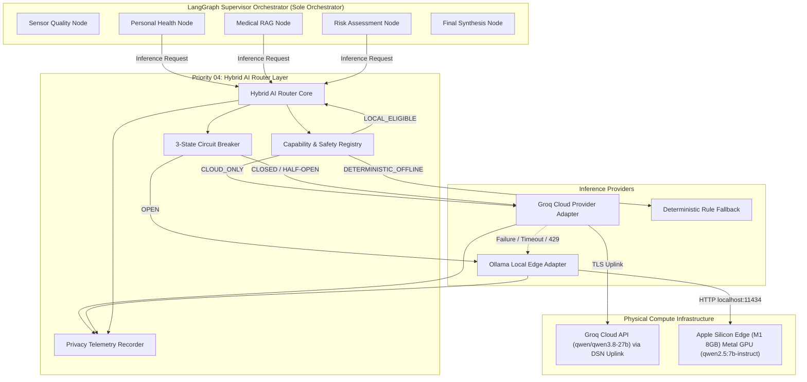

# TRUSTLINE — Priority 04: Hybrid AI Router Architecture
**Subsystem:** Priority 04 — Hybrid AI Router & Local LLM Fallback  
**Role:** Senior Software Architect, Biomedical AI Engineer  
**Date:** November 13, 2026  
**Status:** IMPLEMENTED & VERIFIED  

---

## 1. Architectural Philosophy & Boundaries

The **Hybrid AI Router** is a decoupled inference provider and resilience infrastructure layer designed to ensure zero-downtime clinical decision support onboard the spacecraft. 

### Core Architectural Invariants:
1. **LangGraph Remains Sole Orchestrator:** The Hybrid AI Router is strictly a model-provider selection layer. It does **not** orchestrate multi-agent state graphs, schedule workflows, or coordinate agent dependencies. LangGraph executes the 10-node supervisor DAG.
2. **Deterministic Safety Primacy:** LLMs never possess final authority over clinical classifications, red-line escalations, or sensor quality scores. All LLM outputs (whether from cloud or local edge) pass through deterministic claim validators (`ClaimGroundingValidator`, `ClinicalSynthesisValidator`).
3. **Transparent Fallback & Traceability:** When cloud inference fails, fallback to onboard edge models (`qwen2.5:7b-instruct` via Ollama) occurs transparently, but every telemetry record and supervisor audit trail explicitly logs `is_fallback: True` and the root cause failure reason.

---

## 2. System Architecture Diagram

---

## 3. Request Lifecycle

1. **Request Intake:** Agent constructs a `ProviderRequest` containing `request_id`, `task_category`, `prompt`, `system_prompt`, `temperature`, and `format_json`.
2. **Capability & Policy Verification:** `CapabilityRegistry.get_policy(task_category)` is evaluated:
   - `DETERMINISTIC_OFFLINE`: Routed immediately to rule-based fallback without LLMs.
   - `UNAVAILABLE`: Rejected with `TaskNotEligibleError`.
   - `CLOUD_ONLY`: Permitted to attempt cloud only; if cloud fails, rejects local fallback to prevent safety breaches (e.g. Vision OCR).
   - `LOCAL_ELIGIBLE`: Permitted for both cloud execution and local fallback.
3. **Circuit Breaker Check:** If circuit is `OPEN`, cloud dispatch is short-circuited; request is routed immediately to `OllamaProvider`.
4. **Cloud Dispatch (Groq):** If circuit is `CLOSED` or `HALF_OPEN`, request is dispatched via `GroqProvider` with bounded retries and exponential backoff.
5. **Local Fallback (Ollama):** If Groq encounters timeout, connection loss, or rate limiting, the router catches the normalized exception and dispatches the eligible request to `OllamaProvider` (`qwen2.5:7b-instruct`).
6. **Telemetry & Audit:** The outcome, latency, token throughput, provider, and fallback reason are recorded in privacy-preserving structured telemetry.\n