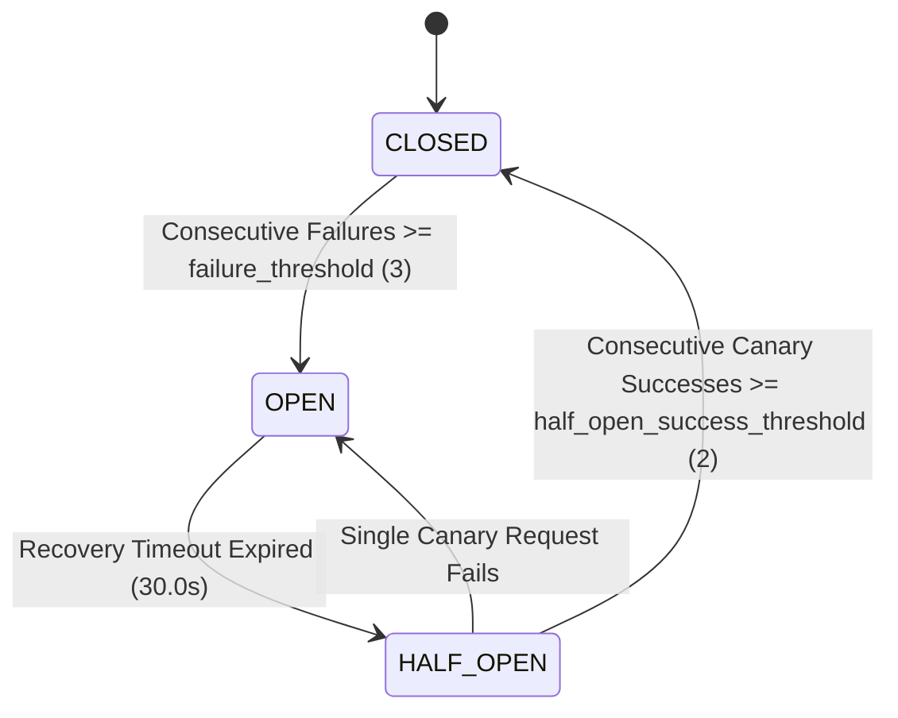

# TRUSTLINE — Priority 04: Deterministic Routing Policies & Circuit Breaker
**Subsystem:** Priority 04 — Hybrid AI Router  
**Role:** Senior Software Architect, QA Auditor  
**Date:** November 13, 2026  
**Status:** IMPLEMENTED & TESTED  

---

## 1. Provider Routing Policy

The Hybrid AI Router enforces deterministic, predictable provider selection:

### 1.1 Normal Operation (Healthy DSN Uplink)
- All eligible requests route to **Groq Cloud** using configured model `qwen/qwen3.8-27b`.
- Fast inference latency (< 500 ms roundtrip).
- Circuit breaker state remains `CLOSED`.

### 1.2 Cloud Failure Classification & Handling
When cloud communication fails, the router classifies the failure into specific exception types:

| Failure Mode | Exception Class | Router Policy | Retry Strategy | Fallback Behavior |
| :--- | :--- | :--- | :--- | :--- |
| **Connection Timeout** | `ProviderTimeoutError` | Degraded cloud | Bounded retry (max 2, backoff 0.5s) | Route eligible tasks to Ollama |
| **Connection Refused** | `ProviderUnavailableError` | Offline DSN link | Bounded retry (max 2, backoff 0.5s) | Route eligible tasks to Ollama |
| **HTTP 429 Rate Limit** | `ProviderRateLimitError` | Throttled | Bounded retry with exponential backoff | Route eligible tasks to Ollama |
| **HTTP 401 Auth Failure** | `ProviderAuthenticationError` | Bad credentials | **Zero retries** (immediate failure) | Route eligible tasks to Ollama |
| **HTTP 5xx Server Error** | `ProviderUnavailableError` | Provider down | Bounded retry (max 2, backoff 0.5s) | Route eligible tasks to Ollama |
| **Malformed Response** | `OutputValidationError` | Data integrity | Parse error caught | Route eligible tasks to Ollama |

---

## 2. Circuit Breaker Specification

To prevent repeated request timeouts from cascading and degrading multi-agent system performance, a three-state **Circuit Breaker** is enforced:

### Parameters:
- `failure_threshold`: 3 consecutive failures trips `CLOSED` to `OPEN`.
- `recovery_timeout`: 30.0 seconds in `OPEN` before probing recovery.
- `half_open_success_threshold`: 2 consecutive successes in `HALF_OPEN` resets to `CLOSED`.

### Anti-Flapping Protection:
- Prevents rapid ping-pong switching between cloud and local providers.
- While `OPEN`, zero cloud calls are dispatched; all eligible requests route directly to local edge, eliminating network latency penalties.

---

## 3. Local Edge Failure & Total Outage Policy

If the local Ollama provider is unreachable or local inference fails:
1. **Preserve Root Cause:** The router raises `ProviderUnavailableError` capturing both the original cloud failure reason and the local failure reason.
2. **Never Fabricate Success:** The router never outputs a dummy or invented response to mask failure.
3. **Deterministic Agent Safety:** Upstream agent catches the provider exception and falls back to its deterministic rule engine (e.g. `_build_deterministic_fallback` in RAA, `generate_grounded_fallback` in PHA).\n