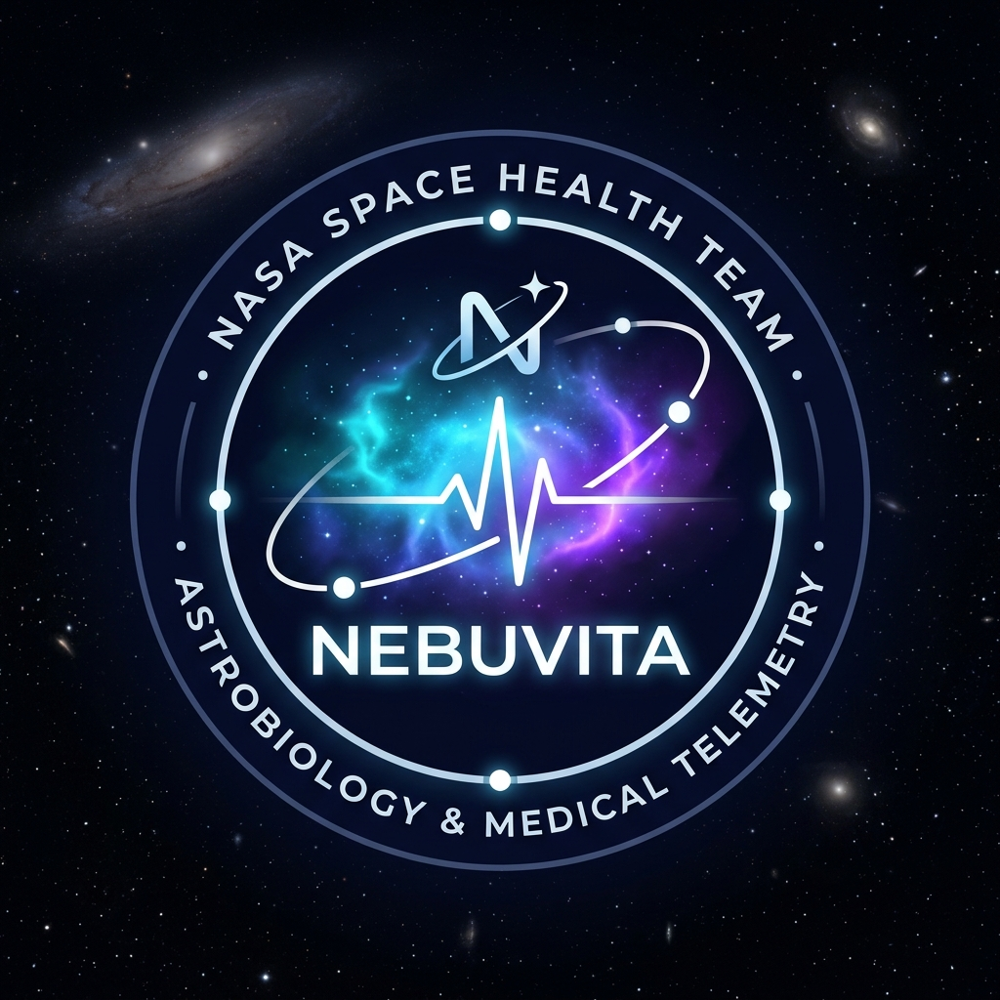
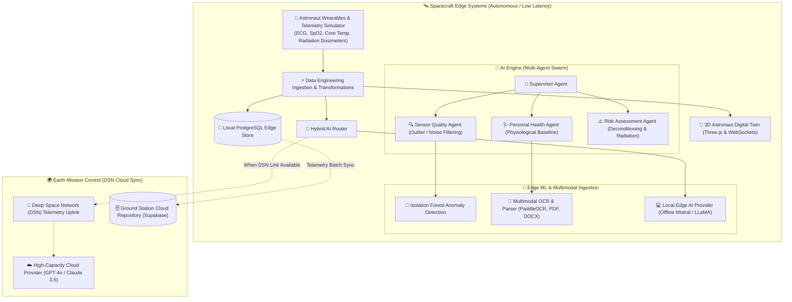

<div align="center">



# 🚀 TRUSTLINE

### Autonomous Space Health Telemetry, Multi-Agent Medical Intelligence & 3D Astronaut Digital Twin

**A NASA Space Exploration & Astrobiology Initiative**  
Engineered by **Team NEBUVITA** (*Astrobiology & Medical Telemetry*)

[](https://www.nasa.gov/)
[](#team-nebuvita)
[](https://python.org)
[](https://fastapi.tiangolo.com/)
[](https://nextjs.org/)
[](https://www.docker.com/)
[](#)

---

</div>

## 📌 Executive Summary

During long-duration crewed deep space missions—such as **Artemis lunar surface sorties** and **crewed Mars transit voyages**—astronauts face physiological stressors unlike anything on Earth: severe microgravity bone/muscle deconditioning, celestial cosmic radiation, cardiovascular remodeling, sensory disruption, and psychological confinement. Crucially, communications through the **Deep Space Network (DSN)** encounter one-way latency delays ranging from several seconds to upwards of **22 minutes**, ruling out real-time telemedicine from Earth ground stations.

**TRUSTLINE** is an end-to-end, autonomous spaceflight clinical decision-support ecosystem and biometric digital twin platform. Built with an offline-resilient **Hybrid AI Architecture**, TRUSTLINE processes multimodal astronaut biosensor feeds in real time onboard the spacecraft, isolates sensor artifacts from true physiological anomalies, assesses cumulative flight risks, and synchronizes with Mission Control when uplink telemetry windows open.

---

## 🌌 Team NEBUVITA

> **"Astrobiology & Medical Telemetry for the Next Era of Human Spaceflight"**

**Team NEBUVITA** is a specialized engineering and research syndicate dedicated to advancing bio-telemetry, edge machine learning, and human digital twin technologies for deep space exploration. Our emblem combines the interstellar nebula of deep space with the vital pulse of human life and orbital celestial trajectories—representing humanity's resilient heartbeat across the cosmos.

---

## 🏛️ System Architecture

TRUSTLINE is organized into discrete, highly decoupled sub-systems designed for mission-critical reliability:



---

## ✨ Key Features & Capabilities

### 1. 🤖 Multi-Agent Medical Intelligence Swarm (`ai-engine/agents/`)
- **Supervisor Agent:** Orchestrates specialized diagnostic agents and prioritizes clinical advisories.
- **Sensor Quality Agent:** Discerning physiological crises from motion artifacts, loose electrode impedance, or sensor drift.
- **Personal Health Agent:** Tracks longitudinal circadian rhythms, heart-rate variability (HRV), and caloric/hydration profiles against pre-flight astronaut baselines.
- **Risk Assessment Agent:** Evaluates acute radiation hazards, cardiovascular deconditioning, and hypoxia probability.

### 2. 🔀 Hybrid AI Engine & Autonomous Offline Routing (`ai-engine/hybrid_ai/`)
- Dynamic routing engine switches seamlessly between:
  - **Local Edge Mode:** Zero-latency onboard inference during DSN blackouts or critical medical emergencies.
  - **Cloud Uplink Mode:** In-depth differential diagnostics, large medical literature synthesis, and ground team review when high-bandwidth DSN channels are active.

### 3. 🌲 Machine Learning Anomaly Detection (`ai-engine/ml/`)
- Baseline physiological modeling and multi-dimensional feature extraction.
- Unsupervised **Isolation Forest** algorithms for early detection of insidious health deterioration trends before overt symptoms appear.

### 4. 📄 Multimodal Document & Flight Log Ingestion (`ai-engine/ocr/`)
- Automated ingestion of flight logs, medical records, and scientific checklists using **PaddleOCR**, PDF, and DOCX parsers.
- Structured extraction feeding directly into the clinical agent knowledge store.

### 5. 🎯 Direct Preference Optimization (DPO) Pipeline (`ai-engine/dpo/`)
- Curated space medicine datasets and alignment pipelines to ensure AI recommendations strictly adhere to NASA Flight Surgeon Protocols and space medicine standards.

### 6. 🧍 3D Human Digital Twin & Telemetry HUD (`frontend/`)
- Interactive **Three.js** 3D anatomical twin visualizing real-time stress points, core temperature maps, heart rate zones, and localized organ telemetry.
- High-frequency live charts and flight surgeon cockpit built with Next.js and WebSockets.

### 7. 🛰️ Spacecraft Sensor Simulator & Data Pipelines (`data-engineering/`)
- High-fidelity telemetry simulator emulating nominal orbital routines, microgravity shifts, extravehicular activity (EVA) metabolic spikes, and anomalous medical events.

---

## 📂 Repository Structure

```text
TRUSTLINE/
├── .env.example                     # Environment template for local & space edge configs
├── docker-compose.yml               # Container orchestrator (Postgres, Backend, AI, Frontend)
├── README.md                        # Project documentation & mission briefing
│
├── ai-engine/                       # Core AI & Medical Intelligence
│   ├── agents/                      # Specialized Autonomous Agent Swarm
│   │   ├── supervisor/              # Multi-agent coordinator
│   │   ├── sensor_quality/          # Noise, drift & artifact rejection
│   │   ├── personal_health/         # Astronaut baseline longitudinal tracking
│   │   └── risk_assessment/         # Acute & cumulative flight risk analysis
│   ├── ml/                          # Statistical & ML Models
│   │   ├── baseline/                # Astronaut pre-flight normative baselines
│   │   ├── isolation_forest/        # Unsupervised outlier & anomaly models
│   │   ├── features/                # Signal processing & feature engineering
│   │   └── evaluation/              # Model performance benchmarks
│   ├── ocr/                         # Multimodal Ingestion Pipeline
│   │   ├── paddle_ocr/              # Optical character recognition engine
│   │   ├── pdf_parser/              # Flight log & clinical PDF extractor
│   │   ├── docx_parser/             # DOCX protocol parser
│   │   └── extraction/              # Structured clinical entity extraction
│   ├── dpo/                         # Clinical Alignment with DPO
│   │   ├── datasets/                # Flight surgeon preference datasets
│   │   ├── training/                # DPO fine-tuning jobs
│   │   ├── evaluation/              # Alignment validation metrics
│   │   └── inference/               # Aligned model checkpoints
│   ├── hybrid_ai/                   # Dynamic Edge / Cloud AI Router
│   │   ├── cloud_provider.py        # DSN uplink cloud model interface
│   │   ├── local_provider.py        # Local spacecraft edge model interface
│   │   └── ai_router.py             # Latency & connectivity arbitration
│   └── tests/                       # AI test suite & clinical validation
│
├── data-engineering/                # Biometric Data Ingestion & Pipelines
│   ├── ingestion/                   # High-throughput sensor streaming
│   ├── simulator/                   # Synthetic spaceflight telemetry generator
│   ├── transformations/             # Signal filtering & cleaning
│   ├── validation/                  # Schema validation & boundary checks
│   ├── pipelines/                   # Automated ETL pipelines
│   └── storage/                     # Time-series & cache adapters
│
├── data-analysis/                   # Astrobiology & Mission Analytics
│   ├── notebooks/                   # Research & exploratory notebooks
│   ├── exploratory_analysis/        # Exploratory data analysis scripts
│   ├── statistical_analysis/        # Statistical significance studies
│   ├── health_trends/               # Longitudinal health degradation models
│   ├── model_evaluation/            # Diagnostic accuracy reports
│   └── reports/                     # Mission briefings & executive summaries
│
├── backend/                         # Mission API & Communication Hub
│   ├── api/                         # RESTful API route definitions
│   ├── auth/                        # Role-based access control (Astronaut/Flight Surgeon)
│   ├── services/                    # Business & clinical logic
│   ├── database/                    # ORM models & session management
│   ├── sync/                        # Delayed DSN ground-station sync protocol
│   ├── websocket/                   # Real-time sub-second biometric streams
│   └── tests/                       # Integration & unit test suites
│
├── frontend/                        # Mission Control & Digital Twin UI
│   ├── components/                  # Reusable UI component library
│   ├── pages/                       # Application views & routing
│   ├── dashboard/                   # Flight surgeon mission control view
│   ├── astronaut/                   # Astronaut personal health monitor
│   ├── human_twin_3d/               # Three.js 3D physiological avatar
│   ├── charts/                      # Real-time WebGL/Canvas telemetry graphs
│   └── hooks/                       # Custom React data hooks & WS handlers
│
├── infrastructure/                  # Deployment & Containerization
│   ├── docker/                      # Service Dockerfiles
│   ├── supabase/                    # Ground-station cloud DB configuration
│   ├── local_postgres/              # Onboard edge database schema
│   └── migrations/                  # Database migration scripts
│
└── documentation/                   # Mission Documentation & Specifications
    ├── architecture/                # Detailed architectural schematics
    ├── api/                         # OpenAPI specs & protocol docs
    ├── data_dictionary/             # Biometric signal schemas & units
    ├── research/                    # Space medicine references & papers
    ├── experiments/                 # Flight simulation experiments
    └── demo/                        # Walkthrough videos & demonstration guides
```

---

## 🛠️ Tech Stack & Tooling

| Domain | Technologies |
|---|---|
| **AI Agents & Orchestration** | LangChain / LangGraph, Pydantic, Python 3.11 |
| **Machine Learning & OCR** | PyTorch, Scikit-learn (Isolation Forest), PaddleOCR, NumPy, Pandas |
| **Edge & Cloud LLMs** | Mistral-7B / LLaMA-3 (Local Onboard), GPT-4o / Claude 3.5 Sonnet (Cloud DSN) |
| **Backend & Real-Time** | FastAPI, Uvicorn, WebSockets, AsyncIO |
| **Frontend & 3D Visualization** | Next.js 14, React, Three.js, React Three Fiber, Tailwind CSS |
| **Databases & Storage** | PostgreSQL 16 (Local Spacecraft Edge), Supabase (Ground Station Cloud) |
| **DevOps & Containers** | Docker, Docker Compose, GitHub Actions |

---

## 🚦 Quickstart & Deployment

### Prerequisites
- [Docker](https://www.docker.com/) & Docker Compose
- Python 3.11+
- Node.js 18+

### 1. Clone & Configure
```bash
# Clone the repository
git clone https://github.com/Alouakhalid/TRUSTLINE.git
cd TRUSTLINE

# Copy environment template
cp .env.example .env
```

### 2. Launch with Docker Compose
```bash
# Boot all services (PostgreSQL, Backend, AI Engine, Frontend)
docker compose up -d
```

### 3. Access Services
- **Mission Control Frontend & 3D Twin:** `http://localhost:3000`
- **FastAPI Telemetry Hub & Docs:** `http://localhost:8000/docs`
- **WebSocket Biometric Stream:** `ws://localhost:8000/ws/telemetry`

---

## 🛡️ Security & Classification

This repository contains research and intellectual property engineered by **Team NEBUVITA** for NASA spaceflight health monitoring systems. Access is restricted to authorized personnel and mission collaborators.

---

<div align="center">
<sub>Engineered with pride by <b>Team NEBUVITA</b> · Powered by NASA Space Health & Astrobiology Innovations</sub>
</div>
