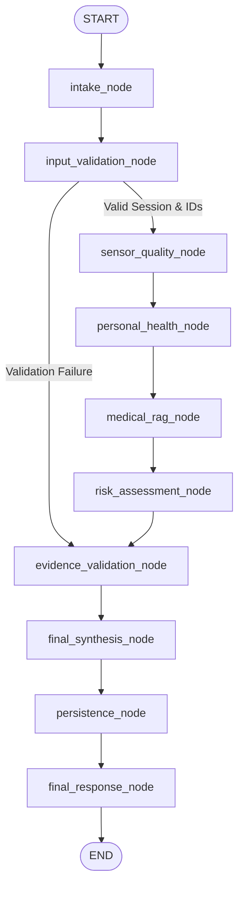
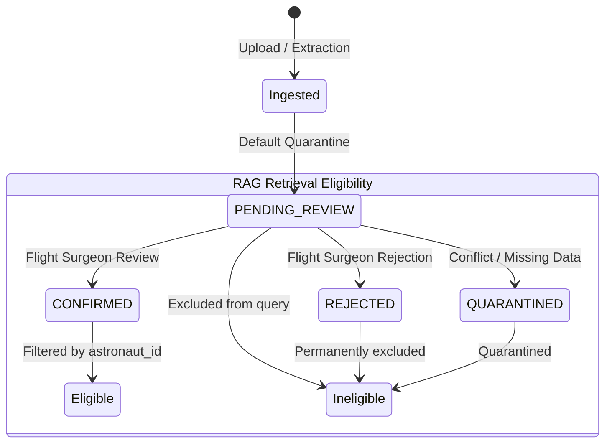
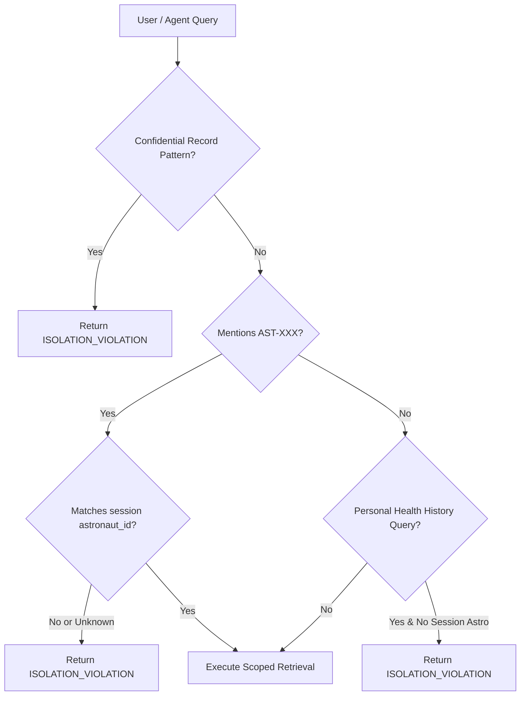

# TRUSTLINE Priority 02: Medical Knowledge RAG Architecture

## 1. Subsystem Overview & Architectural Philosophy

The **Medical Knowledge Retrieval-Augmented Generation (Medical RAG)** subsystem provides clinically grounded, provenance-traceable aerospace medical knowledge to the TRUSTLINE multi-agent monitoring platform. Operating under strict spaceflight safety constraints, the Medical RAG subsystem ensures that all medical reasoning is anchored in verified mission operational guidelines, flight surgeon clinical thresholds, and formally confirmed astronaut laboratory records.

### Non-Negotiable Architectural Principles
1. **Single Orchestrator Invariant:** LangGraph (`StateGraph`) remains the sole orchestrator. No secondary orchestrators (such as external CrewAI workflows or competing state machines) manage the top-level execution loop.
2. **Read-Only Telemetry Invariant:** The RAG subsystem functions as an evidence provider. It strictly produces read-only `EV-KNOW-*` evidence items and never modifies live physiological telemetry streams ($\Delta \text{HR} = 0.0\,\text{bpm}, \Delta \text{Resp} = 0.0\,\text{br/min}$).
3. **P01 Review Lifecycle Enforcement:** Clinical records extracted from medical documents (Priority 01) are gated by flight surgeon review status. Only `CONFIRMED` records are queryable. `PENDING_REVIEW`, `REJECTED`, and `QUARANTINED` records are strictly excluded at retrieval time.
4. **Astronaut Identity Isolation:** All patient-specific retrieval is strictly partitioned by `astronaut_id`. Cross-astronaut record queries or queries from unverified/unknown sessions immediately trigger isolation defenses and return `ISOLATION_VIOLATION`.
5. **Deterministic Grounding & Abstention:** When relevant aerospace clinical literature is absent or below threshold, the generator safely abstains without fabricating physiological thresholds, clinical diagnoses, or citation references.

---

## 2. LangGraph Supervisor DAG Integration

The TRUSTLINE supervisor workflow is orchestrated as a 10-node directed acyclic graph (DAG) using LangGraph `1.0.7`. The Medical RAG subsystem is integrated as the dedicated `medical_rag_node`.



### DAG Execution Flow
1. **`intake_node`:** Initializes workflow session, timestamps high-resolution monotonic start time, and validates payload formatting.
2. **`input_validation_node`:** Validates astronaut ID and session ID. Invalid identities route directly to `evidence_validation_node` for safe quarantine.
3. **`sensor_quality_node` (SQA):** Evaluates sensor integrity (ECG, EDA, RESP, EMG, ACC, TEMP), computes signal-to-noise ratio, and flags sensor artifacts or flatlines.
4. **`personal_health_node` (PHA):** Extracts physiological features (HRV RMSSD, mean heart rate, respiration rate), processes multi-modal symptoms, and retrieves confirmed historical records.
5. **`medical_rag_node`:** Executes hybrid medical knowledge retrieval and grounded generation scoped to the active session and astronaut identity.
6. **`risk_assessment_node` (RAA):** Aggregates telemetry evidence, clinical findings, and medical guidelines across 10 health domains to compute risk tiers.
7. **`evidence_validation_node`:** Cross-examines all compiled evidence items, verifies cryptographic hashes and provenance chains, and quarantines invalid or conflicting items.
8. **`final_synthesis_node`:** Integrates verified evidence and RAG guidance into an astronaut-facing clinical summary with strict safety disclaimers.
9. **`persistence_node`:** Records the complete immutable assessment, evidence registry, and execution timings to SQLite and JSON storage.
10. **`final_response_node`:** Generates final structured API response and records total workflow duration.

---

## 3. Evidence Registry Integration (`EV-KNOW-*`)

Every piece of medical knowledge retrieved by the RAG subsystem is converted into an auditable evidence object registered in the global `EvidenceRegistryService`:

```json
{
  "evidence_id": "EV-KNOW-NASA-STD-3001-A2",
  "source_agent": "medical_knowledge_rag_service",
  "domain": "CLINICAL_KNOWLEDGE",
  "evidence_type": "APPROVED_MISSION_PROTOCOL",
  "observed_value": "EVA Heart Rate Limits: Sustained HR > 160 bpm exceeds mission red-line and mandates immediate abort.",
  "confidence_score": 0.95,
  "validity_status": "VALID",
  "is_quarantined": false,
  "quarantine_reason": null,
  "provenance": "Medical RAG Hybrid Retrieval: NASA-STD-3001-VOL-1:P12",
  "timestamp": "2026-11-12T18:40:00Z"
}
```

### Conflict Preservation & Quarantine
If retrieved passages contain contradictory recommendations (e.g., one guideline recommending immediate exercise while another mandates strict rest), the retriever flags `conflict_detected = True` and emits `RAGRetrievalStatus.CONFLICT_DETECTED`. The `evidence_validation_node` flags the item with `is_quarantined = True` and `quarantine_reason = "Conflicting clinical evidence"`, ensuring unvetted contradictions never compromise risk decisions.

---

## 4. Priority 01 Document Review Lifecycle Integration

The RAG subsystem directly queries the P01 `MedicalDocumentRepository` to surface verified astronaut clinical data. The review lifecycle transitions are strictly respected:



| Document Status | RAG Eligibility | System Action |
|:---|:---|:---|
| `CONFIRMED` | **Eligible** | Retrieved with full provenance (`document_id`, `confirmation_timestamp`, `confirmed_by`, `test_name`, `extracted_value`, `reference_range`). |
| `PENDING_REVIEW` | **Ineligible** | Quarantined in SQLite; excluded by database filter `review_status = 'CONFIRMED'`. |
| `REJECTED` | **Ineligible** | Permanently excluded from retrieval index. |
| `QUARANTINED` / `CONFLICTING` | **Ineligible** | Flagged as conflicted; excluded from trusted answers. |

---

## 5. Ingestion Engine Architecture

The ingestion pipeline (`MedicalDocumentIngestionService`) parses heterogeneous aerospace medicine literature and indexes chunks into the vector store:

```
[Document Files] -> [Parser Pipeline] -> [Semantic Chunker] -> [Metadata Enricher] -> [ChromaDB + BM25]
  - PDF (PyMuPDF)       - Table Parser      - Heading Hierarchy   - Trust Status       - Dense Index
  - DOCX (python-docx)  - Image Extractor   - Chunk Overlap       - Medical Domain     - Lexical Corpus
  - TXT / Markdown      - Security Guard    - Content Hash        - Page Citations
  - JSON Guidelines
```

### Security Guards in Ingestion
1. **Decompression Bomb Guard:** Files exceeding 50 MB uncompressed or with expansion ratios exceeding 100:1 are rejected immediately.
2. **Path Traversal Guard:** Ingestion paths are normalized and canonicalized to prevent traversal outside approved directories.
3. **SHA-256 Deduplication:** Duplicate document contents are detected via SHA-256 hashes to prevent redundant index growth.

---

## 6. Hybrid Retrieval Engine

The `HybridMedicalRetriever` implements fused retrieval balancing dense semantic comprehension with sparse lexical keyword matching:

$$\text{Score}(d, q) = w_{\text{dense}} \cdot S_{\text{dense}}(d, q) + w_{\text{sparse}} \cdot S_{\text{bm25}}(d, q) + \beta_{\text{protocol}}$$

Where:
- $w_{\text{dense}} = 0.65$: Sentence-Transformer dense cosine similarity.
- $w_{\text{sparse}} = 0.35$: BM25Okapi lexical matching score.
- $\beta_{\text{protocol}} = 0.20$: Precedence boost applied exclusively to `OFFICIAL_GUIDELINE` chunks.
- $\theta = 0.25$: Minimum relevance threshold below which candidates are discarded.

### Astronaut Scoping & Isolation Defense


---

## 7. Grounded Generation Engine

The `GroundedMedicalGenerator` synthesizes retrieved evidence into a structured 5-part aerospace clinical response:

1. **`1. Retrieved Medical Facts:`** Direct factual extractions from retrieved literature and confirmed laboratory findings.
2. **`2. Clinical Interpretation:`** Analysis strictly confined to retrieved facts without speculative leaps or unauthorized diagnoses.
3. **`3. Operational Recommendations:`** Concrete mission operational recommendations aligned with NASA/ESA flight rules.
4. **`4. Source Citations:`** Formal bibliographic references with document IDs, section titles, and page numbers.
5. **`5. Confidence & Grounding Limitations:`** Explicit statements regarding evidence completeness, conflict status, or data limitations.

### Grounding Validation & Deterministic Fallback
When an external LLM is configured (e.g., Groq `llama-3.3-70b-versatile`), responses undergo automated grounding validation via regex and token extraction. If the generator fabricates numerical values, hallucinates dates, or references unretrieved documents, the synthesis is rejected and the engine falls back to a deterministic, template-based synthesis constructed directly from retrieved excerpts.

---

## 8. Telemetry Immutability Invariant

Medical RAG execution is guaranteed to be non-intrusive. Across all 14 Core telemetry features:
- $\Delta \text{HR} = 0.0\,\text{bpm}$
- $\Delta \text{Resp} = 0.0\,\text{br/min}$
- $\Delta \text{RMSSD} = 0.0\,\text{ms}$
- $\Delta \text{EDA} = 0.0\,\mu\text{S}$
- $\Delta \text{TEMP} = 0.0\,^\circ\text{C}$

The RAG subsystem executes concurrently or sequentially within the LangGraph DAG without write access to upstream sensor telemetry buffers.
