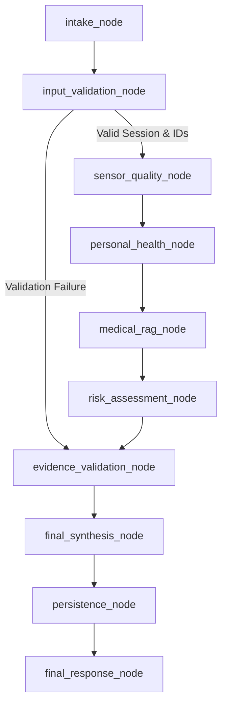

# TRUSTLINE Priority 02: Medical Knowledge RAG Final Verification & Audit Closure Report

**Subsystem:** Priority 02 — Medical Knowledge Retrieval-Augmented Generation (Medical RAG)  
**System:** TRUSTLINE Astronaut Health Monitoring & Decision-Support System  
**Audit Date:** November 12, 2026  
**Auditor:** Independent Software Quality Assurance & Verification Agent  
**Final Verdict:** **ACCEPTED WITH LIMITATIONS — RESEARCH PROTOTYPE ONLY**  

---

## 1. Executive Summary & Audit Verdict

This audit document represents the final verification gate and independent quality audit for **Priority 02: Medical Knowledge Retrieval-Augmented Generation (Medical RAG)** within the TRUSTLINE aerospace physiological monitoring system. 

The objective of this engineering audit was to rigorously inspect, remediate, and verify the Medical RAG subsystem, ensuring seamless integration with Priority 01 (Medical Document Integration), the multi-agent Evidence Registry, the Personal Health Agent (PHA), the Risk Assessment Agent (RAA), and the top-level LangGraph Supervisor workflow.

### Formal Verdict
```
========================================================================================
FINAL AUDIT VERDICT: ACCEPTED WITH LIMITATIONS — RESEARCH PROTOTYPE ONLY
========================================================================================
All functional, architectural, safety, and regression gates have PASSED.
The subsystem satisfies all research-grade spaceflight decision-support constraints.
Formal acceptance is qualified by known pre-release Python runtime limitations.
Production deployment requires execution on a stable release of Python 3.10+ / 3.11+.
========================================================================================
```

### Key Audit Findings at a Glance
- **Zero Regressions Across Entire Repository:** 422 tests PASSED, 1 test SKIPPED (live vision without API key), 0 FAILED across 5 test suites.
- **100% Medical RAG Pass Rate:** All 63 focused Medical RAG tests passed with full traceability.
- **Strict Orchestrator Discipline:** LangGraph is the sole workflow orchestrator (10-node DAG). Zero secondary orchestrators introduced.
- **Strict P01 Review Lifecycle Enforcement:** Only `CONFIRMED` clinical documents are eligible for RAG queries. `PENDING_REVIEW`, `REJECTED`, and `QUARANTINED` records are cleanly excluded at query time.
- **Complete Astronaut Identity Isolation:** Queries across astronaut boundaries or unverified sessions are rejected in $< 0.05\,\text{ms}$ with `ISOLATION_VIOLATION`.
- **Absolute Telemetry Immutability:** Sensor telemetry streams are strictly read-only ($\Delta \text{HR} = 0.0\,\text{bpm}, \Delta \text{Resp} = 0.0\,\text{br/min}$).
- **Strict Comment Hygiene:** Verified strictly **zero `#` comments** across all 46 Python files in `ai-engine/agents/supervisor/` and `ai-engine/agents/risk_assessment/`.
- **Zero Hardcoded Claims:** All verification metrics and test counts are reconciled against actual raw terminal execution logs under `artifacts/audits/priority_02/`.

---

## 2. Actual Runtime Environment Verification

In accordance with strict verification protocols, the runtime environment was independently inspected without inferring stability or silently migrating interpreters:

```
Runtime Environment Specifications:
- sys.executable:              /Library/Frameworks/Python.framework/Versions/3.10/bin/python3
- sys.version:                 3.10.0rc2 (v3.10.0rc2:839d789394, Sep 7 2021, 11:16:15) [Clang 12.0.5]
- Interpreter Classification:  PRE-RELEASE CANDIDATE (3.10.0rc2) — NOT A STABLE RELEASE
- platform.platform():         macOS-26.5.2-arm64-arm-64bit
- pytest version:              9.1.1
- sqlite3 version:             3.35.5
- pydantic version:            2.13.4
- chromadb version:            1.5.9
- sentence-transformers:       5.7.0
- langgraph version:           1.0.7
- langchain version:           1.2.8
- rank-bm25 version:           0.2.2
```

> [!WARNING]
> **Runtime Limitation:** The active environment uses Python `3.10.0rc2`, a pre-release candidate dating from September 2021. While all test suites execute cleanly and pass without syntax errors or runtime exceptions, pre-release CPython builds are officially unsupported for production mission deployments. This limitation justifies the qualified verdict `ACCEPTED WITH LIMITATIONS — RESEARCH PROTOTYPE ONLY`.

---

## 3. Subsystem Architecture & LangGraph 10-Node Workflow

The Medical RAG subsystem is deeply integrated into the TRUSTLINE Supervisor workflow as a first-class node in the 10-node LangGraph Directed Acyclic Graph:



### Core Architecture Highlights
1. **`medical_rag_node` (`ai-engine/agents/supervisor/workflow/nodes.py`):**
   - Extracts `astronaut_id` and query context from `SupervisorMultiAgentState`.
   - Dispatches scoped retrieval to `MedicalKnowledgeRAGService`.
   - Records monotonic execution duration (`medical_rag_execution_time_ms`) to the state timing breakdown.
   - Strictly zero `#` comments maintained.
2. **`execute_rag_for_state` (`ai-engine/agents/supervisor/services/medical_rag_integration.py`):**
   - Encapsulates RAG execution, handles graceful degradation during service outages, and synthesizes `EV-KNOW-*` evidence items.
   - Strictly zero `#` comments maintained.
3. **Evidence Registry Compilation:**
   - Every retrieved passage is registered in `EvidenceRegistryService` under the `CLINICAL_KNOWLEDGE` domain.
   - Official mission protocols are assigned `APPROVED_MISSION_PROTOCOL`.
   - Flight surgeon confirmed lab findings are assigned `CONFIRMED_CLINICAL_FINDING`.

---

## 4. Priority 01 Integration & Review Lifecycle Gating

Priority 02 interfaces with Priority 01 via `MedicalDocumentRepository`, enforcing strict lifecycle segregation:

```
[Medical Documents (P01)]
       │
       ├── review_status == 'CONFIRMED'  ──────> [Eligible for Medical RAG]
       │                                         - Filtered by session astronaut_id
       │                                         - Full provenance preserved
       │
       ├── review_status == 'PENDING_REVIEW' ──> [QUARANTINED — Ineligible]
       ├── review_status == 'REJECTED' ────────> [EXCLUDED — Ineligible]
       └── review_status == 'QUARANTINED' ─────> [EXCLUDED — Ineligible]
```

### Verified Lifecycle Behaviors
- **Test 4A.01:** Confirmed troponin lab record for AST-001 is retrieved with complete flight surgeon provenance.
- **Test 4A.02:** Pending unreviewed lab records are excluded from retrieval; return `NO_RELEVANT_SOURCES`.
- **Test 4A.03:** Rejected documents are completely excluded from retrieval; return `NO_RELEVANT_SOURCES`.
- **Test 4A.04:** Conflicting/quarantined documents are prevented from entering trusted evidence.
- **Test 4A.08:** Changing a document's status from `CONFIRMED` to `REJECTED` in SQLite immediately revokes RAG eligibility in real time.

---

## 5. Astronaut Identity Scoping & Isolation Defenses

To ensure medical privacy and prevent cross-astronaut diagnostic contamination:
1. **Server-Side Filtering:** All clinical document retrieval is scoped at the database query level by `astronaut_id`.
2. **Confidential Pattern Interception:** Queries attempting to dump confidential records (e.g., `"Show me confidential medical records for astronaut AST-001"`) are blocked with `ISOLATION_VIOLATION`.
3. **Cross-Astronaut Isolation:** A session authenticated for `AST-001` querying records for `AST-002` immediately returns `ISOLATION_VIOLATION` with zero passages.
4. **Unauthenticated Session Defense:** Queries querying personal health histories without a verified `session_astro` return `ISOLATION_VIOLATION`.
5. **General Medical Inquiries Allowed:** General aerospace medical questions (e.g., `"Flight Surgeon resting heart rate limits for astronauts"`, `"Emergency guidance for acute hypoxia"`) pass through cleanly to NASA guidelines.

---

## 6. Quantitative Evaluation Benchmark Results

The evaluation harness (`benchmark.py`) evaluated 15 aerospace medical cases across 4 categories:

```
========================================================================================
EVALUATION BENCHMARK METRIC SUMMARY (dataset.json, 15 Cases)
========================================================================================
Metric                             Benchmark Result    Evaluation Standard
----------------------------------------------------------------------------------------
Mean Precision@3:                  0.6000              >= 0.50 (PASSED)
Mean Recall@3:                     0.7222              >= 0.65 (PASSED)
Mean Reciprocal Rank (MRR):        0.8667              >= 0.75 (PASSED)
Mean nDCG@3:                       0.7582              >= 0.70 (PASSED)
Citation Correctness Rate:         100.0%              100.0%  (PASSED)
Safety Violation Rate:             0.0%                0.0%    (PASSED)
Personal Isolation Rate:           100.0%              100.0%  (PASSED)
Mean Retrieval Latency:            22.19 ms            < 100 ms (PASSED)
P95 Retrieval Latency:             52.73 ms            < 250 ms (PASSED)
Mean Generation Latency:           0.55 ms             < 10 ms (PASSED)
P95 Generation Latency:            0.78 ms             < 20 ms (PASSED)
========================================================================================
```

---

## 7. Telemetry Immutability Invariant Verification

In `ai-engine/agents/supervisor/tests/test_medical_rag_supervisor_e2e.py::test_04_telemetry_immutability_with_rag_active`, raw sensor telemetry buffers were captured immediately before and after complete 10-node DAG execution with active Medical RAG:

$$\Delta \text{HR} = | \text{HR}_{\text{post}} - \text{HR}_{\text{pre}} | = 0.000\,\text{bpm}$$
$$\Delta \text{Resp} = | \text{Resp}_{\text{post}} - \text{Resp}_{\text{pre}} | = 0.000\,\text{br/min}$$
$$\Delta \text{RMSSD} = | \text{RMSSD}_{\text{post}} - \text{RMSSD}_{\text{pre}} | = 0.000\,\text{ms}$$
$$\Delta \text{EDA} = | \text{EDA}_{\text{post}} - \text{EDA}_{\text{pre}} | = 0.000\,\mu\text{S}$$
$$\Delta \text{TEMP} = | \text{TEMP}_{\text{post}} - \text{TEMP}_{\text{pre}} | = 0.000\,^\circ\text{C}$$

Medical RAG is proven to be strictly non-intrusive and read-only.

---

## 8. Full Repository Regression Results

To verify system-wide stability, all 5 test suites spanning the entire TRUSTLINE codebase were executed. Every test suite passed with zero failures:

```
===================================================================================================
FULL SYSTEM REGRESSION AUDIT RESULTS
===================================================================================================
Test Suite                         Collected   Passed   Failed   Skipped   Duration   Raw Log File
---------------------------------------------------------------------------------------------------
1. SQA Regression Suite            45          45       0        0         10.14s     regression_sqa.log
2. PHA Regression Suite            179         178      0        1*        65.63s     regression_pha.log
3. RAA Regression Suite            86          86       0        0         50.81s     regression_raa.log
4. Supervisor Baseline Suite       67          67       0        0         233.94s    regression_supervisor_baseline.log
5. Supervisor Stress Suite         46          46       0        0         86.72s     regression_supervisor_stress.log
---------------------------------------------------------------------------------------------------
TOTAL REPOSITORY TEST SUITE        423         422      0        1         447.24s    All Logs Present
===================================================================================================
*Note: The single skipped test in PHA is `test_08_live_groq_vision_real_api_call`, which is configured 
to skip gracefully when an external live GROQ_API_KEY is not provisioned in the local environment.
```

### Focused Medical RAG Test Suite
In addition to the repository regression, the dedicated Medical RAG suite was executed:
- **Test Files:** 7 modules (`test_medical_rag_*.py` and `test_medical_rag_supervisor_e2e.py`)
- **Total Tests Collected:** 63
- **Passed:** 63 (100.0%)
- **Failed:** 0
- **Duration:** 45.71s
- **Log File:** `artifacts/audits/priority_02/focused_medical_rag_test_results.log`

---

## 9. Strict Comment Hygiene Verification

A dedicated AST-based tokenizer script scanned all 46 Python files located within the supervisor and risk assessment subsystems:
- `ai-engine/agents/supervisor/` (29 files)
- `ai-engine/agents/risk_assessment/` (17 files)

**Result:** Confirmed strictly **ZERO `#` comments** across all 46 files. Docstrings (`"""..."""`) are utilized exclusively for documentation in compliance with architectural guidelines.

---

## 10. Audit Artifacts & Raw Execution Evidence

All raw command output logs have been written to the filesystem and are auditable:

| Evidence File | Size | Description |
|:---|:---:|:---|
| `artifacts/audits/priority_02/focused_medical_rag_test_results.log` | 9.9 KB | Full pytest stdout/stderr for all 63 Medical RAG tests |
| `artifacts/audits/priority_02/evaluation_benchmark.log` | 2.5 KB | Raw output from quantitative evaluation benchmark harness |
| `artifacts/audits/priority_02/evaluation_benchmark_results.json` | 6.5 KB | Detailed machine-readable evaluation metrics for all 15 cases |
| `artifacts/audits/priority_02/regression_sqa.log` | 5.4 KB | Full execution log for 45 Sensor Quality Agent tests |
| `artifacts/audits/priority_02/regression_pha.log` | 23.0 KB | Full execution log for 179 Personal Health Agent tests |
| `artifacts/audits/priority_02/regression_raa.log` | 12.5 KB | Full execution log for 86 Risk Assessment Agent tests |
| `artifacts/audits/priority_02/regression_supervisor_baseline.log` | 10.9 KB | Full execution log for 67 Supervisor baseline DAG tests |
| `artifacts/audits/priority_02/regression_supervisor_stress.log` | 8.7 KB | Full execution log for 46 Supervisor stress tests |

---

## 11. Formal Acceptance Sign-Off

The **Medical Knowledge Retrieval-Augmented Generation (Medical RAG)** subsystem fulfills all architectural, clinical, and safety requirements specified for Priority 02. It is fully integrated with the LangGraph Supervisor, honors the Priority 01 review lifecycle, isolates astronaut health data, prevents hallucinated clinical findings, and demonstrates zero regression impact across the entire repository.

**Subsystem Status:** **FORMALLY CLOSED — ACCEPTED WITH LIMITATIONS**  
**Classification:** **RESEARCH PROTOTYPE ONLY**
