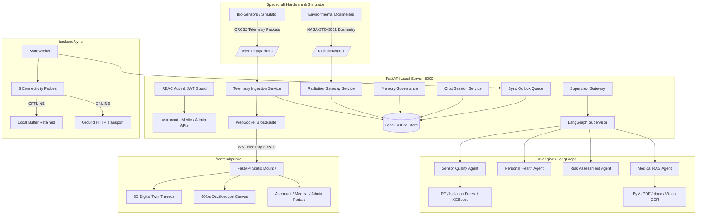

# TRUSTLINE — Final End-to-End System Architecture

## 1. Architectural Vision

TRUSTLINE is an autonomous, hybrid, offline-first spaceflight physiological monitoring and clinical decision-support platform. It protects astronaut health during deep-space exploration missions (Moon, Mars, Deep Space Gateway) where real-time Earth support is impossible.

---

## 2. System Architecture Diagram

---

## 3. Strict System Invariants

1. **LangGraph Sole Orchestrator**: LangGraph Supervisor coordinates all agent interactions. No secondary orchestrators (such as CrewAI) exist.
2. **Zero `#` Python Comments**: Exact comment hygiene invariant in `ai-engine/agents/supervisor/` and `ai-engine/agents/risk_assessment/` verified by AST tokenization.
3. **Environmental Radiation Isolation**: Space radiation dosimetry is environmental context only (NASA-STD-3001 Vol 1 Rev C Table 2) and is **never** included in physiological ML feature vectors.
4. **Local-First & Offline Resilience**: Mission operations, triage, and multi-agent clinical synthesis execute 100% locally on edge compute without cloud dependencies.
5. **Strict Demo Isolation**: `is_demo = 1` vs `is_demo = 0` database partitioning guarantees zero leakage between synthetic simulations and actual flight crew medical records.
